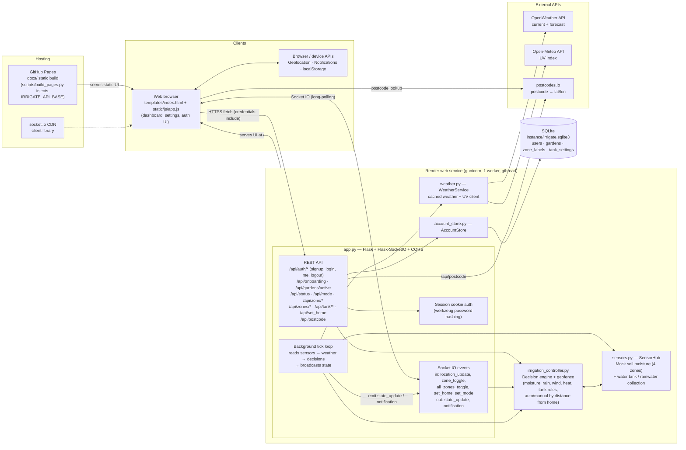

# Irrigate — Architecture

Smart garden irrigation web app: a Flask + Socket.IO backend on Render, and a vanilla-JS dashboard (served by Flask or as a static copy on GitHub Pages).

## Key data flows

1. **Login / onboarding** — browser → `/api/auth/*`, `/api/onboarding` → `AccountStore` → SQLite. Session cookie (SameSite=None, Secure on Render) authorises later calls, including cross-origin from GitHub Pages.
2. **Live dashboard** — the background tick reads mock sensors, fetches cached garden weather (OpenWeather + Open-Meteo UV), runs the decision engine, then pushes `state_update` and `notification` over Socket.IO.
3. **Geofencing** — the browser's GPS sends `location_update`; the controller switches Auto (> 1 mi from home) / Manual (< 1 mi). Weather always uses the saved garden location.
4. **User control** — zone / mode / tank actions go over Socket.IO events or REST, update controller state, and are broadcast back to all clients.

## Configuration
Env vars: `OPENWEATHER_API_KEY`, `SECRET_KEY`, `HOME_LAT`, `HOME_LON`, `HOME_POSTCODE`, `HOME_LABEL`, `DATABASE_PATH`, `WATER_SUPPLIER`, allowed CORS origins.
